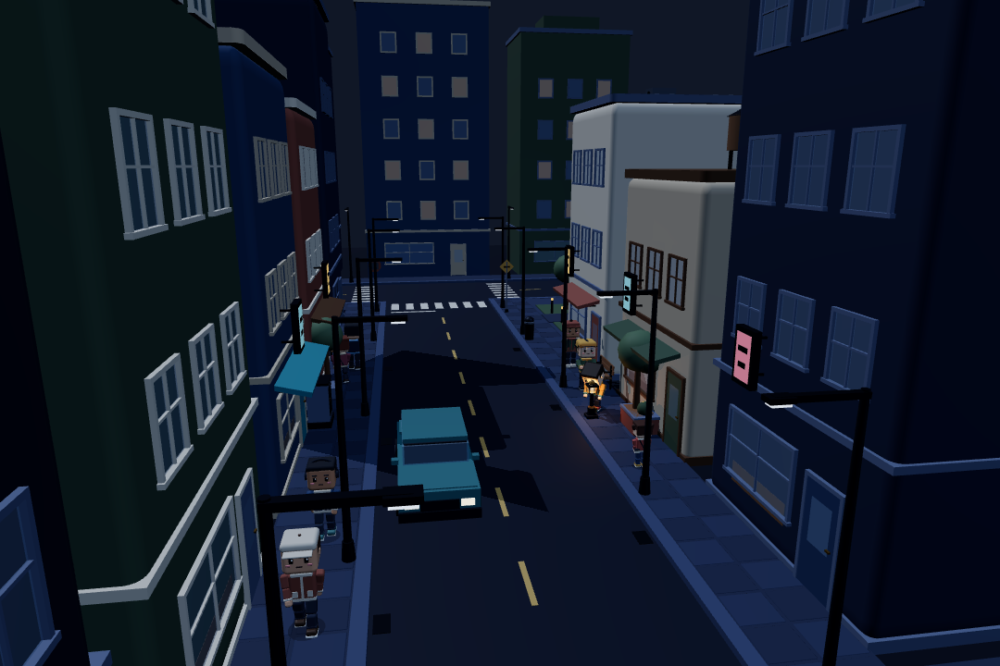
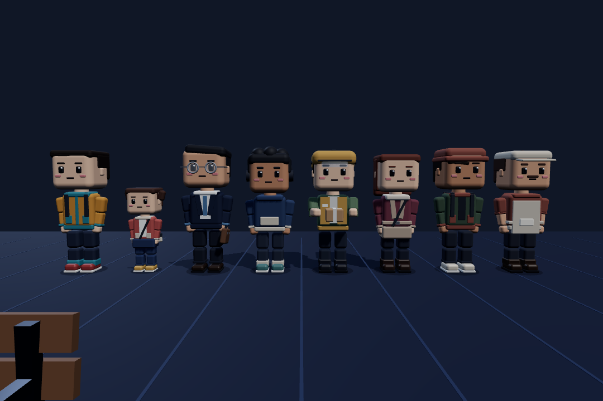
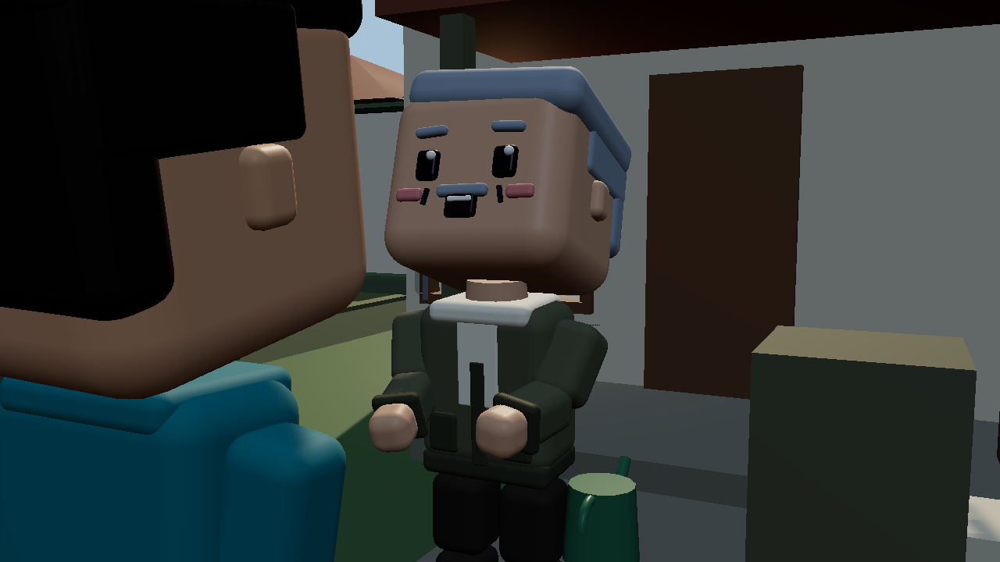
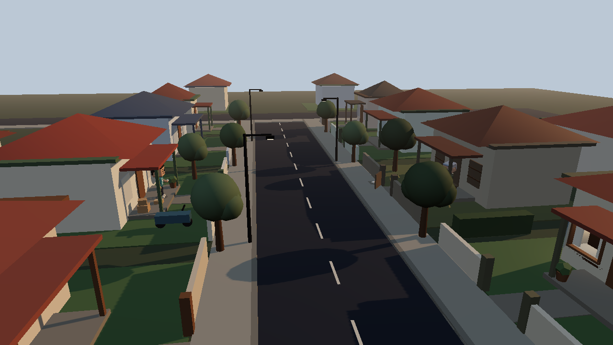

# BLOCKY TOY — 3D Animation Skill

> Build code-based 3D animated films as **coherent, functioning worlds** inhabited by **distinct, acting individuals**—from 20-second clips to multi-act 15-minute short films—with any AI coding agent.

**BLOCKY TOY** (`blocky-toy`) is a portable, engine-agnostic **Agent Skill** (`SKILL.md` open standard) compatible with **Google Antigravity**, **Claude Code**, **OpenCode**, **OpenAI Codex CLI**, **Cursor**, and any coding agent that reads Markdown instructions.

<p align="center">
  
  
  
  
</p>

- **Project `test-ai-video` — *The Last Little Light* (`42s`, `9:16` Reels, stereo mix)**: [`docs/media/showcase-film-540p.mp4`](./docs/media/showcase-film-540p.mp4)
- **Project `test-ai-video` — 7-Act Dialogue & Lip-Sync QA (`41s`)**: [`docs/media/dialogue-qa-demo.mp4`](./docs/media/dialogue-qa-demo.mp4)
- **Project `test-1` — *Rumah Sebelah* (`180s / 3m`, `16:9` `id-ID` Script Mode)**: [`docs/media/test1-rumah-sebelah-540p.mp4`](./docs/media/test1-rumah-sebelah-540p.mp4)
- **Full Visual Gallery, Renders & Breakdown**: [`docs/SHOWCASE.md`](./docs/SHOWCASE.md)

---

## Features at a Glance

- **Two Authoring Modes (`Idea Mode` & `Script Mode`)**: Generate a full animated film from a title/concept (`/blocky-toy "The Last Train Home"`) OR translate an author's Markdown/plain-text screenplay verbatim (`/blocky-toy --script ./scripts/story.md`) without rewriting lines or endings.
- **Selectable Output Aspect Ratio (Reels `9:16` Default)**: Defaults cleanly to **`9:16` Reels portrait (`1080×1920`)** when omitted; switch effortlessly via `--format landscape` (`16:9`), `portrait`/`reels`, `4:5`, `1:1`, or `WxH` with aspect-aware camera blocking (`scripts/parse-script-outline.mjs`).
- **Flexible Runtime (`15s` to `15m+`) & Strict Project Isolation**: Supports short clips (`15–60s`), stories (`1–3m`), and multi-act short films (`3–15m+`) with a mandatory pre-build estimation gate and strictly project-local incremental caching (zero asset or render-cache carryover from prior projects).
- **Global Art Direction, Material Separation & Window Craft**: Enforces one centralized 9-domain palette (`references/art-direction.md`, `templates/art-direction.md`), distinct PBR roughness across skin, hair, clothing, footwear, metal, wood, glass, and concrete, 12-part/7-pivot character anatomy, real framed recessed windows (never flat glowing rectangles), and restrained bloom/fog (`scripts/validate-art-direction.mjs`).
- **Explicit Scene Time, Environmental Storytelling & Temporal Continuity**: Enforces per-scene `dayIndex`, `clockTime`, solar angle/direction, shadow length factor, color temperature, sky gradients, and synchronized environmental cues (traffic, headlights, streetlights, interior windows, birds, wind sway, soundscape) via `scripts/atmosphere-presets.mjs` + `scripts/validate-atmosphere.mjs`, preventing ambiguous lighting or unexplained morning-to-night jumps.
- **Atmospheric Sky, Layered Nature & Diurnal Time-Lapse**: Enforces multi-stop vertical sky domes (never flat gray), drifting clouds, soil-bordered lawns with 3D instanced grass tufts, and smooth `morning → noon → afternoon → dusk → night` progression (`interpolateAtmosphereState`).
- **Living-World Population & Real-World Consistency**: Enforces connected roads, intersection-only crosswalks, cornering braking, zero vehicle teleports, centralized metric scale (`1u = 1m` across characters, vehicles, buildings & furniture via `references/world-scale.md`), and context-fit background NPCs, traffic, and biome-authentic animals so outdoor streets feel alive.
- **Pose-Aware Grounding & Full-Body Collision**: Solves `surfaceTopY(x, z)` and exact posed mesh bounds (`poseMinY`) across standing, sitting, and detailed resting (`loaf`, `sphinx_lie`, `side_lie`, `curled_sleep`, `recline`) poses—plus full sub-mesh & articulated-door collision for humans, animals, and props.
- **Identity Lock, Clean Head/Accessory Geometry & Cast Diversity**: Prevents "recolored clone" characters and unexplained/floating head or body blocks via structured `CharacterIdentityProfile` geometry (hair, silhouettes, sleeves, footwear, audited accessories) plus `locked: true` canonical asset reuse and cross-scene `continuityState`.
- **Multilingual Dialogue, Natural Soundscape & Context-Aware Audio**: Separates external `narration` (mouths shut) from `dialogue` (WAV RMS-aligned visemes, mid-sentence `expressionArc`, gaze tracking, listener reactions, and interruption cutoffs) with zero mandatory API keys (`msedge-tts` fallback), prioritizes speech over scene-specific low-volume environmental soundscapes (no hiss/rumble or generic wind loops), and treats background music as optional—used only when narratively earned (`references/lip-sync-and-audio.md`).
- **Token-Efficient & Code-Based**: Progressive disclosure (`SKILL.md` is `< 95` lines) adapts cleanly to code-based 3D pipelines (`Three.js/R3F`, `WebGL/Babylon.js`, `Godot`, `Unity`) without Blender or heavy boilerplate.

---

## Quick Installation (Any Agentic AI)

Run via `npx` (once published to npm) or directly from a local clone (`Node.js >= 18`):

```bash
# Via npx (after npm publish) into your current project:
npx blocky-toy --target all --project /path/to/your-project

# Or from a local clone across Antigravity, Claude Code, OpenCode, Codex CLI & Cursor:
node /Users/macos/Developer/blocky-toy/scripts/install.mjs --target all --project /path/to/your-project

# Or install globally in your home directory (~/.agents, ~/.claude, ~/.config/opencode, ~/.codex, ~/.cursor):
node /Users/macos/Developer/blocky-toy/scripts/install.mjs --target all --scope global
```

### Target-Specific One-Liners

| Agentic AI | Project-Local Install | Global Install |
| :-- | :-- | :-- |
| **Google Antigravity** | `node scripts/install.mjs --target antigravity` | `node scripts/install.mjs --target antigravity --scope global` |
| **Claude Code** | `node scripts/install.mjs --target claude` | `node scripts/install.mjs --target claude --scope global` |
| **OpenCode** | `node scripts/install.mjs --target opencode` | `node scripts/install.mjs --target opencode --scope global` |
| **OpenAI Codex CLI** | `node scripts/install.mjs --target codex` | `node scripts/install.mjs --target codex --scope global` |
| **Cursor** | `node scripts/install.mjs --target cursor` | `node scripts/install.mjs --target cursor --scope global` |

- Add `--copy` if you prefer copied files over symlinks (automatically omits heavy `docs/media/` demo videos unless `--with-media` is specified).
- Add `--dry-run` to preview destination paths, or `--uninstall` to remove cleanly.
- Detailed manual symlinks, troubleshooting & verification steps: [`docs/INSTALLATION.md`](./docs/INSTALLATION.md).

---

## Repository Structure

```text
blocky-toy/
├── SKILL.md                               # Concise entrypoint & 14-stage adaptive workflow
├── README.md                              # Complete overview, installation & usage docs
├── docs/
│   ├── INSTALLATION.md                    # Detailed setup for Antigravity, Claude Code, OpenCode, Codex, Cursor
│   ├── SHOWCASE.md                        # Visual gallery & demo video breakdown
│   └── media/                             # Verified screenshots & H.264 showcase MP4s
│       ├── showcase-film-540p.mp4         # test-ai-video (42s, 9:16 Reels showcase)
│       ├── dialogue-qa-demo.mp4           # test-ai-video (41s, 7-act dialogue QA)
│       ├── test1-rumah-sebelah-540p.mp4   # test-1 (180s, 16:9 id-ID Script Mode)
│       ├── world-aerial-masterplan.png
│       ├── world-street-avenue.png
│       ├── cast-diversity-front.png
│       ├── cast-diversity-back.png
│       ├── scene-dialogue-twoshot.png
│       ├── dialogue-qa-reaction.png
│       ├── test1-aerial-neighborhood.png
│       ├── test1-cast-lineup.png
│       ├── test1-dialogue-twoshot.png
│       └── test1-finale-street.png
├── references/                            # Loaded on-demand via progressive disclosure
│   ├── input-modes-and-script-parsing.md
│   ├── production-workflow.md
│   ├── long-form-production.md
│   ├── worldbuilding.md
│   ├── art-direction.md
│   ├── world-scale.md
│   ├── real-world-consistency.md
│   ├── character-design.md
│   ├── dialogue-and-acting.md
│   ├── lip-sync-and-audio.md
│   ├── cinematography.md
│   ├── animation-physics.md
│   └── quality-assurance.md
├── templates/                             # Engine-agnostic planning specs
│   ├── script-input.md
│   ├── production-plan.md
│   ├── character-profile.md
│   ├── art-direction.md
│   ├── scale-test-scene.md
│   ├── scene-definition.md
│   ├── world-state.md
│   └── dialogue-timeline.md
├── examples/                              # Self-contained Three.js visual test harnesses
│   ├── atmosphere-visual-test/            # Morning / Noon / Afternoon / Night + transition validator
│   └── art-direction-exploration/         # Isolated A/B/C/D art-direction comparison harness
└── scripts/                               # Zero-dependency Node ESM utilities
    ├── atmosphere-presets.mjs
    ├── install.mjs
    ├── parse-script-outline.mjs
    ├── validate-art-direction.mjs
    ├── validate-atmosphere.mjs
    ├── validate-world-scale.mjs
    └── wav-rms-viseme-aligner.mjs
```

---

## Production Modes & Controls

```text
# Idea Mode (defaults to 9:16 Reels portrait 1080x1920 when --format is omitted)
/blocky-toy "The Last Train Home" --duration 5m --language en-US

# Explicit Landscape (16:9 widescreen 1920x1080) or Portrait (9:16 / reels)
/blocky-toy --script ./scripts/story.md --duration 10m --format landscape --style "stylized blocky twilight"
```

Optional controls (`--duration`, `--language`, `--style`, `--voice`, `--format` [`portrait`/`reels`/`9:16` default `1080×1920`, or `landscape`/`16:9`, `4:5`, `1:1`], `--script`) all fall back to sensible inferred defaults when omitted.

### Example Prompts

1. **One-Speaker Character Clip (`Idea Mode`)**:
   > Use `blocky-toy`. Build a 25-second stylized evening streetlamp scene in English where one character (**Leo**) notices a flickering lantern, fixes the loose switch, and speaks one quiet line (*"Finally... much better."*). Verify spatial clearance, grounding, WAV-aligned visemes, and 4-view renders.
2. **Multilingual Conversation (`Script Mode` / Dialogue)**:
   > Use `blocky-toy`. Create a 15-second cafe patio dialogue between **Dina** (`es-ES`) and **Andi** (`en-US`) with a mid-sentence interruption. Design distinct non-cloned character silhouettes, persistent zero-key `msedge-tts` profiles, eye-contact tracking, delayed listener reactions, and `'rest'` pause spans verified by `scripts/wav-rms-viseme-aligner.mjs`.
3. **Coherent Stylized City Tour (`Weather + Traffic + Animals`)**:
   > Use `blocky-toy`. Create a 20-second silent camera tour of a stylized rainy twilight city using Three.js. Enforce connected intersections, corner-braking closed traffic loops, wet pavement reflections, umbrellas, wind-staggered canopies, and perched park birds before rendering final aerial, street-level, and hero views.

---

## Bundled Utility Verification

All bundled Node scripts in `scripts/` require zero `npm install` dependencies:

```bash
npm test
# Or run individually:
node scripts/install.mjs --self-test
node scripts/parse-script-outline.mjs --self-test
node scripts/wav-rms-viseme-aligner.mjs --self-test
node scripts/validate-world-scale.mjs --self-test
node scripts/validate-art-direction.mjs --self-test
node scripts/validate-atmosphere.mjs --self-test
```

### Visual Atmosphere & Art-Direction Harnesses (`examples/`)

To validate `morning` / `noon` / `afternoon` / `night` differentiation, temporal continuity, and A/B/C/D art-direction variations in Three.js:

```bash
# Validate temporal continuity & 4-period contrast manifest
node examples/atmosphere-visual-test/validate-manifest.mjs

# Install local Three.js test dependency (only inside examples/atmosphere-visual-test) and start preview server
npm --prefix examples/atmosphere-visual-test install
node examples/atmosphere-visual-test/server.mjs
# Open:
# - http://127.0.0.1:4173/examples/atmosphere-visual-test/index.html
# - http://127.0.0.1:4173/examples/art-direction-exploration/index.html
```

---

## Known Limitations

- **Default TTS Network & Local Fallbacks**: `msedge-tts` provides zero-key neural voices in the reference setup, requiring network reachability unless paired with an offline binary (`piper`, `espeak-ng`, macOS `say`).
- **Orthographic Phoneme Approximation**: `scripts/wav-rms-viseme-aligner.mjs` supports RMS envelopes + Roman-script digraph/grapheme rules (`en`, `id`, `es`, `fr`, `ja`, `universal`). Non-Roman scripts require romanization or a phoneme frontend first.
- **2D Planar Navigation Guidance**: The reference A* obstacle solver assumes a single walkable elevation (`y = const`). Multi-story interiors or sloped hills require engine-native 3D NavMeshes (`NavigationAgent` / Recast).
- **Generic Agent Fallback**: Agents that do not auto-discover `SKILL.md` directories can read `SKILL.md` directly via prompt/project rules (`AGENTS.md` / `GEMINI.md` / `CLAUDE.md`).
