# BLOCKY TOY Showcase — Production Outputs & Render Gallery

Verified outputs and inspection renders generated with **BLOCKY TOY** (`blocky-toy`) using Three.js / React Three Fiber + Playwright Chromium + FFmpeg + zero-key `msedge-tts`.

---

## Project 1 (`test-ai-video`) — *The Last Little Light* (`42s`, `9:16` Reels)

Produced in **Idea Mode** (`1080×1920 @ 30 FPS` master, `540×960` showcase encode) featuring connected urban districts, 8 distinct non-cloned characters, moonlit practical streetlamps, and synchronized WAV RMS lip-sync.

### Video Demos (`test-ai-video`)

- **Full Short Film Showcase (540×960, 42s, mixed audio)**: [`docs/media/showcase-film-540p.mp4`](./media/showcase-film-540p.mp4)
- **Dialogue Performance & Lip-Sync QA Suite (960×540, 41s, 7 acts)**: [`docs/media/dialogue-qa-demo.mp4`](./media/dialogue-qa-demo.mp4)

### 1. Worldbuilding & Spatial Common Sense

Connected urban blocks (`Commercial`, `Residential Maple Lane`, `Pocket Park`, `Commercial Parking Lot`, and outer perimeter connectors), intersection-only zebra crossings, lane-facing signs, and zero parked vehicle overlaps:

| Elevated Urban Masterplan Overview | Main Commercial Avenue & Traffic |
| :---: | :---: |
|  |  |

### 2. Character Identity Lock & Visual Diversity

Eight distinct individuals (`Leo`, `Mina`, `Andi`, `Raka`, `Bintang`, `Dina`, `Sari`, `Pak Hendra`) featuring non-cloned silhouettes, varied sleeves (`long` vs. `rolled`), footwear (`hi_tops`, `sneakers`, `loafers`, `boots`), facial details, and 360°-readable hairstyles:

| Cast Turnaround — Front Lineup | Cast Turnaround — Back View (360° Hair & Gear) |
| :---: | :---: |
| 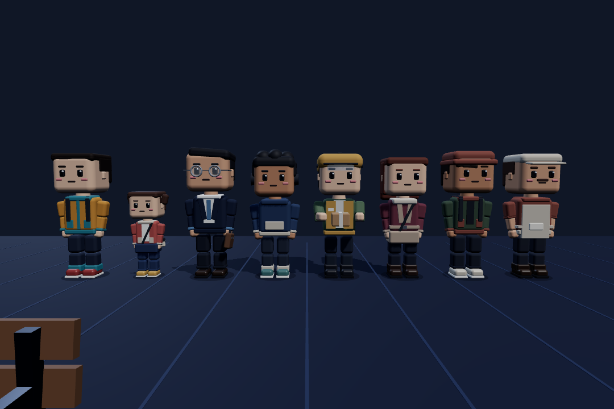 | 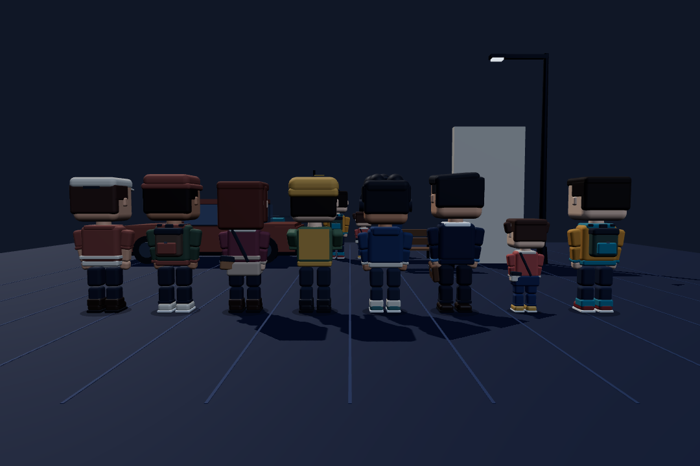 |

### 3. Character Acting, Dialogue Turn-Taking & Lighting Continuity

On-screen character conversation with WAV RMS-aligned visemes, closed mouths during external narration, eye-contact tracking, delayed listener reactions, and moonlit key shadows synchronized to sky/fixture sources:

| Film Scene 4 — Leo & Mina Dialogue Two-Shot | Dialogue QA Act 3 — Expressive Reaction & Gaze |
| :---: | :---: |
| 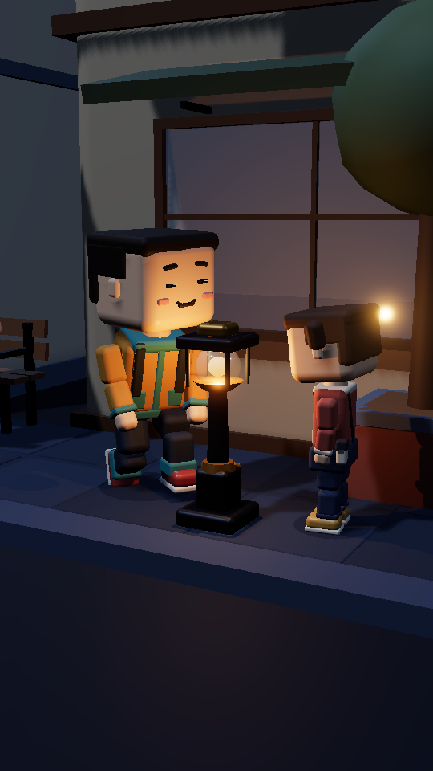 |  |

---

## Project 2 (`test-1`) — *Rumah Sebelah* (`3:00` / `180s`, `16:9` Indonesian Script Mode)

Produced in **Script Mode** (`1280×720 @ 30 FPS` master, `960×540` showcase encode, `5,400` frames across 6 scenes) in Indonesian (`id-ID`) with locked cast (`Raka`, `Pak Arman`, `Kucing Tua`) and incremental per-scene rendering.

### Video Output (`test-1`)

- **Full 3-Minute Short Film Output (960×540, 180s, stereo audio)**: [`docs/media/test1-rumah-sebelah-540p.mp4`](./media/test1-rumah-sebelah-540p.mp4)

### Render Gallery (`test-1`)

| Aerial Residential Street (*Jalan Kenanga*) | Locked Cast Lineup (`Raka`, `Pak Arman`, `Kucing Tua`) |
| :---: | :---: |
| 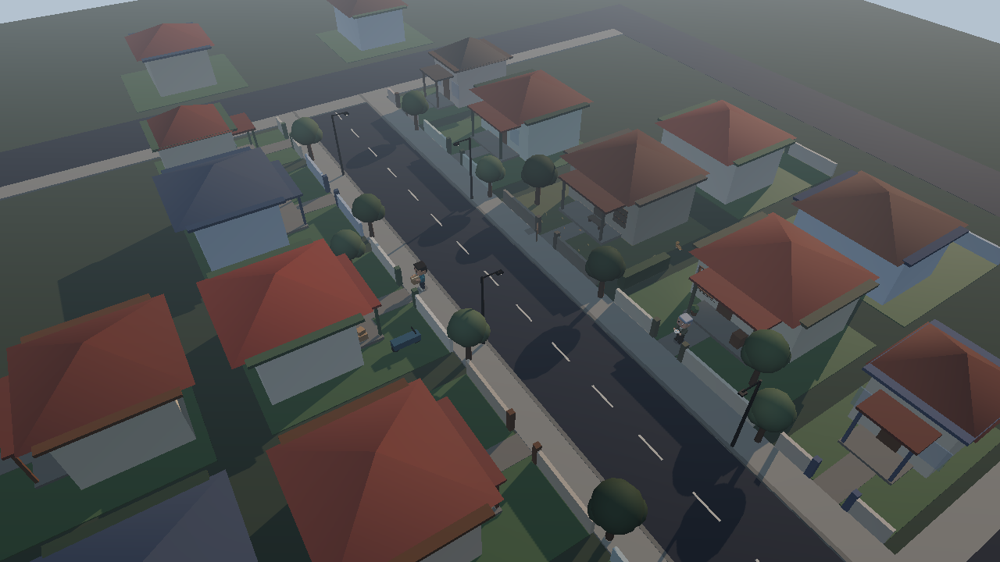 | 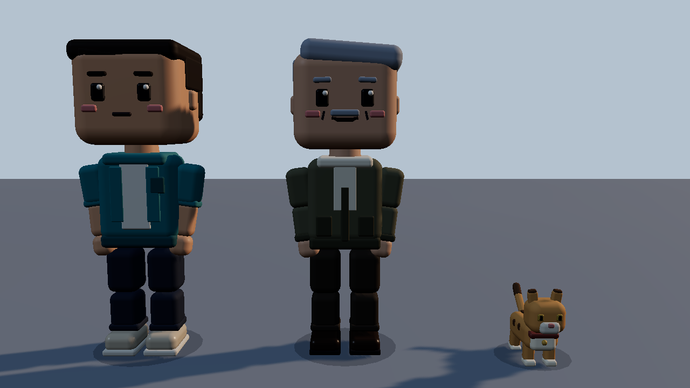 |

| Scene 4 — OTS Dialogue Two-Shot | Scene 6 — Morning Finale Wide Shot |
| :---: | :---: |
| 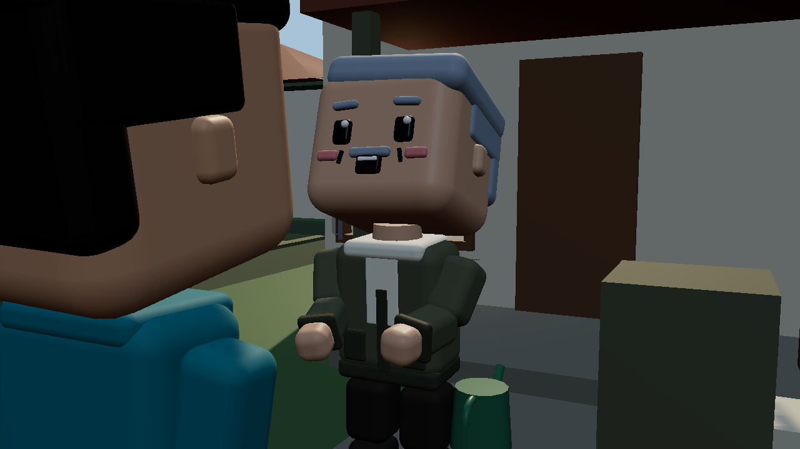 | 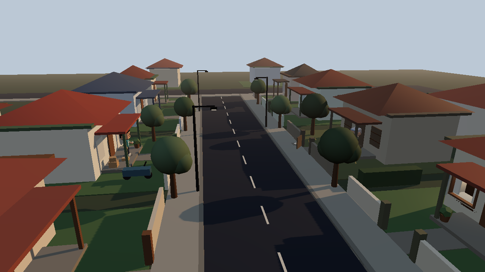 |

> **Skill Evolution Driven by `test-1` Audit**: Real-world visual audits from `test-1` directly motivated `blocky-toy` updates for **pose-aware grounding & detailed resting poses** (preventing resting animals from sinking into porches), **full sub-mesh & closed-door collision**, **multi-stop sky domes & 3D instanced grass tufts**, **living-world ambient NPC/traffic/animal budgets**, **diurnal morning-to-night time-lapse rules**, **strict project isolation**, and **`9:16` Reels default formatting**.

---

## Project 3 (`test-2`) — *Rumah Sebelah* v2 (`3:03` / `183s`, `16:9` Full HD Indonesian Script Mode)

Produced in **Script Mode** (`1920×1080 @ 24 FPS` master, `960×540` showcase encode across 6 scenes) iterating on `test-1` with higher-resolution rendering, articulated front gate opening, surface-aware cat contact beside the food plate, and golden-hour multi-stop sky gradients (`Raka`, `Pak Arman`, `Ibu Sari`, `Mas Budi`, `Kucing Tua`).

### Video Output (`test-2`)

- **Full 1080p-Master Short Film Showcase (960×540, 183s, stereo audio)**: [`docs/media/test2-rumah-sebelah-540p.mp4`](./media/test2-rumah-sebelah-540p.mp4)

### Render Gallery (`test-2`)

| Scene 3 — Cat & Articulated Gate Contact | Scene 6 — Golden-Hour Neighborhood Finale |
| :---: | :---: |
| 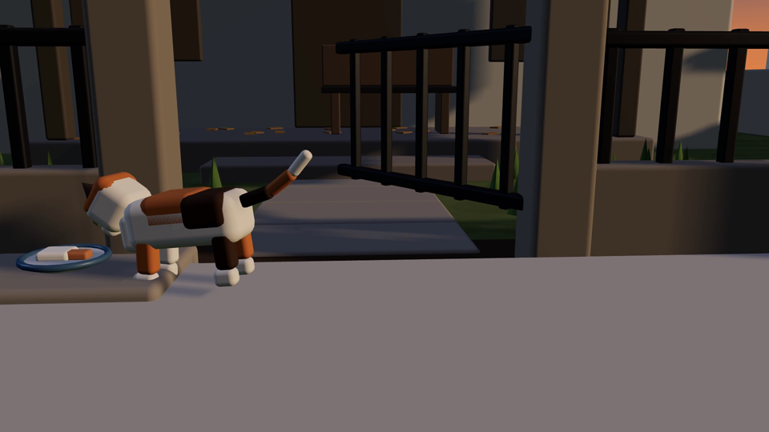 | 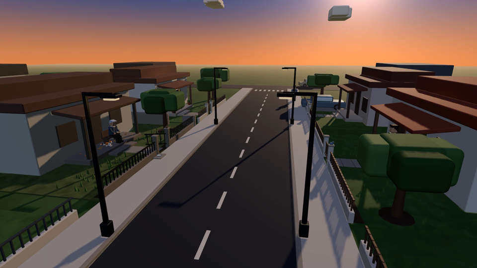 |

---

## Project 4 (`test-3`) — *Rumah Sebelah* v3 (`3:00` / `180s`, `16:9` Art-Directed Indonesian Script Mode)

Produced in **Script Mode** (`1280×720 @ 24 FPS` master, `960×540` showcase encode, `4,320` frames across 6 scenes) integrating centralized 9-domain art direction, framed recessed windows, 3D instanced grass tufts, dawn-to-morning atmospheric continuity, and dialogue-first natural audio mixing (`Raka`, `Pak Arman`, `Ibu Sari`, `Pak Budi`, `Kucing Tua`).

### Video Output (`test-3`)

- **Art-Directed Short Film Showcase (960×540, 180s, stereo audio)**: [`docs/media/test3-rumah-sebelah-540p.mp4`](./media/test3-rumah-sebelah-540p.mp4)

### Render Gallery (`test-3`)

| Aerial Dawn Street (*Jalan Kenanga*) | Scene 5 — Porch Dialogue & Warm Lighting |
| :---: | :---: |
| 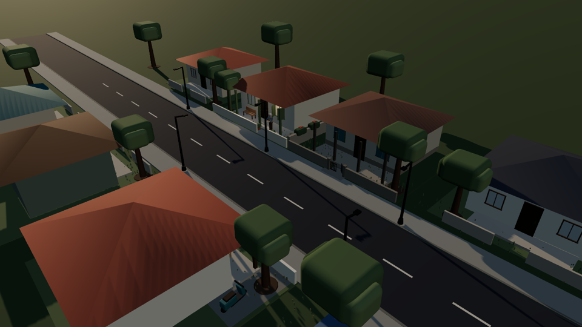 | 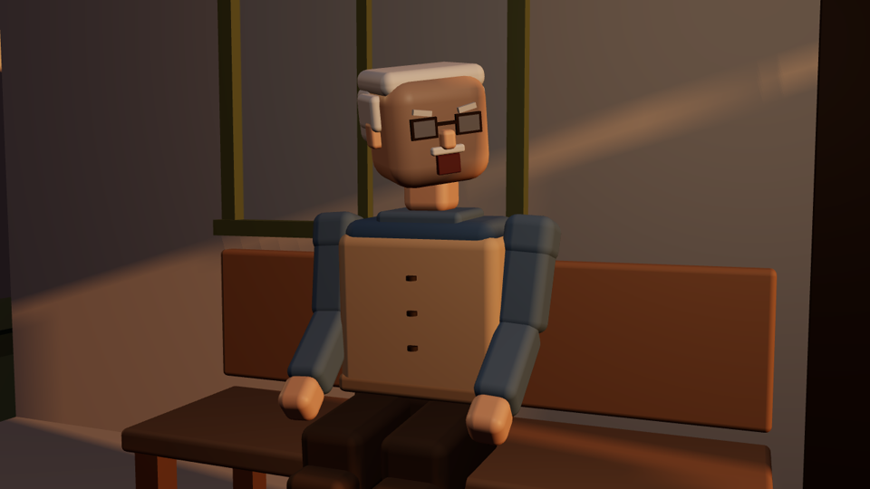 |

---

## Project 5 (`test-4`) — *10 Tahun Lagi* (`67.54s`, `9:16` Reels Indonesian Idea Mode)

Produced in **Idea Mode** (`1080×1920 @ 24 FPS` Reels portrait master, `540×960` showcase encode, `1,621` frames across 2 scenes: afternoon cafe debate → dusk synthesis) with a 7-character cast + cat (`Raka`, `Sari`, plus neighborhood cast), shared `blocky-locomotion-v1` controller, 2D A* collision-free navigation, closed curb-filleted traffic loops, automated 5-suite validators, and scene-specific ambience (afternoon sparrows, dusk crickets, and an earned dusk Rhodes cue).

### Video Output (`test-4`)

- **Reels Short Film Showcase (540×960, 67.5s, stereo audio)**: [`docs/media/test4-sepuluh-tahun-lagi-540p.mp4`](./media/test4-sepuluh-tahun-lagi-540p.mp4)

### Render Gallery (`test-4`)

| 7-Character Cast Lineup + Cat | Elevated Dusk Intersection & Traffic |
| :---: | :---: |
| 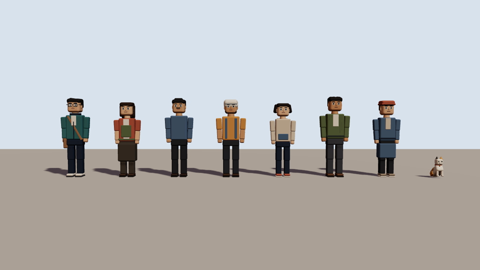 | 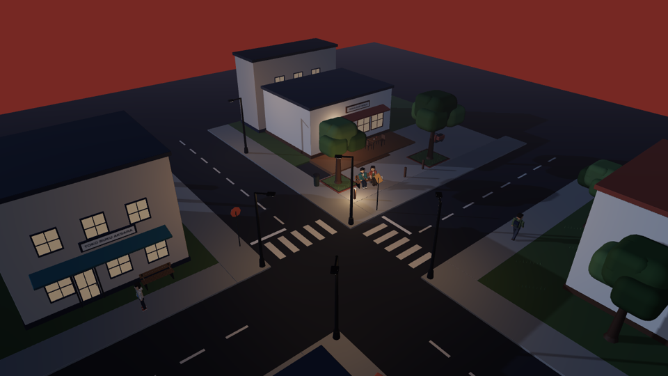 |

| Scene 2 — Dusk Bench Synthesis (`9:16`) | Finale Rising Street View (`9:16`) |
| :---: | :---: |
| 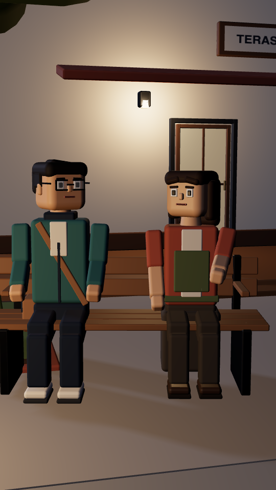 | 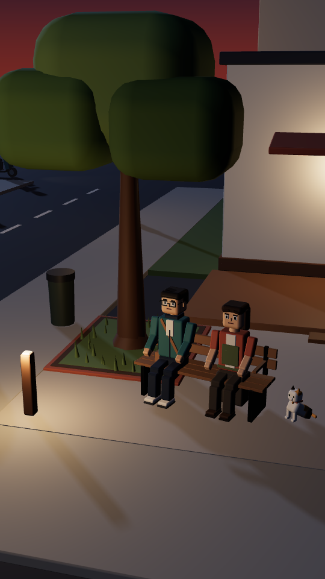 |

> **Skill Evolution Driven by `test-2` → `test-4` Audits**: Production audits across `test-2`, `test-3`, and `test-4` directly drove `blocky-toy` updates for **centralized art direction & temporal atmosphere continuity** (`test-2`/`test-3`), **LEGO/Roblox-style walking cycles with blocky knee bends & lifted shoe soles**, **rider-bound motorcycles vs. road-following cars**, **non-boxy A-line/beveled skirt & garment silhouettes** (identified on Sari's skirt in `test-4`), and **minimal TTS voice processing** (replacing clause-splitting & heavy compression to eliminate synthetic AI voice artifacts).

---

## Visual Validation Suites (`examples/`)

### 1. Time-of-Day & Temporal Continuity (`examples/atmosphere-visual-test/`)

Rendered from an identical environment and camera (`[-8.6, 4.3, 14.2]`) driven by `scripts/atmosphere-presets.mjs` and verified by `scripts/validate-atmosphere.mjs`:
- **Morning (`07:30`, `22°` East, `4600K`)**: Long west-pointing shadows, peach-blue horizon, active birds & morning pedestrians, streetlamps off.
- **Noon (`12:15`, `74°`, `5800K`)**: Short compact overhead shadows, bright midday azure sky, peak street activity.
- **Afternoon (`17:05`, `14°` West, `3300K`)**: Long warm east-pointing shadows, golden-hour sky gradient, early interior window warmth.
- **Night (`21:30`, `-28°` sun / moonlit, `7500K`)**: Starry indigo sky, localized streetlamp pools, car headlights/taillights on, recessed interior windows warmly lit without overexposure, birds roosting.

| 4-Period Same-Camera Comparison | Afternoon → Dusk Transition (`~17:49`) |
| :---: | :---: |
| 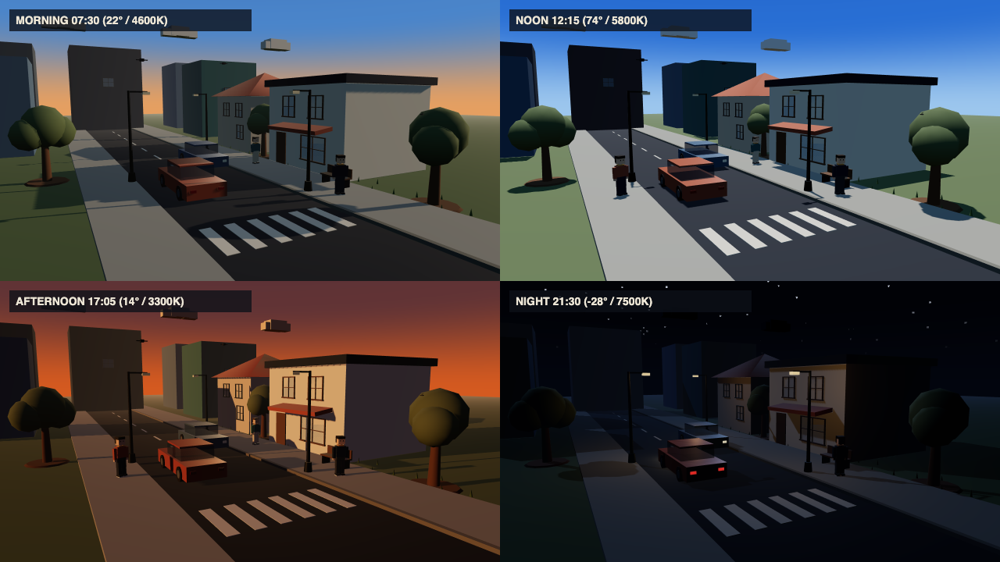 | 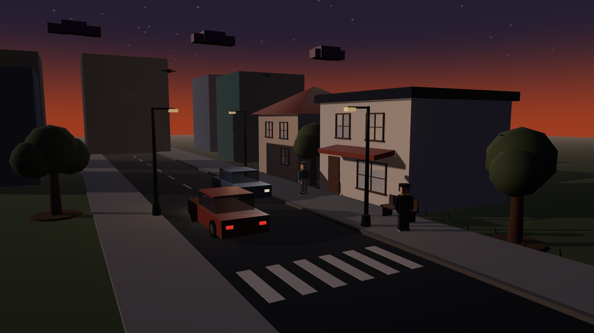 |

### 2. Art Direction Exploration (`examples/art-direction-exploration/`)

Isolated 4-way visual exploration preserving identical geometry, camera, and base palette while comparing **A. Cinematic Natural**, **B. Artistic Cinematic**, **C. Premium Stylized**, and **D. Atmospheric Storytelling**:

| 2×2 Art Direction Comparison Grid |
| :---: |
| 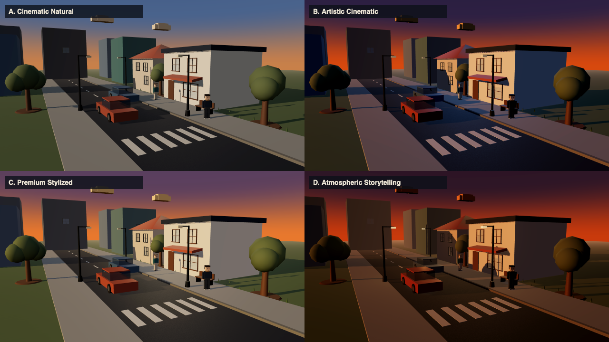 |
