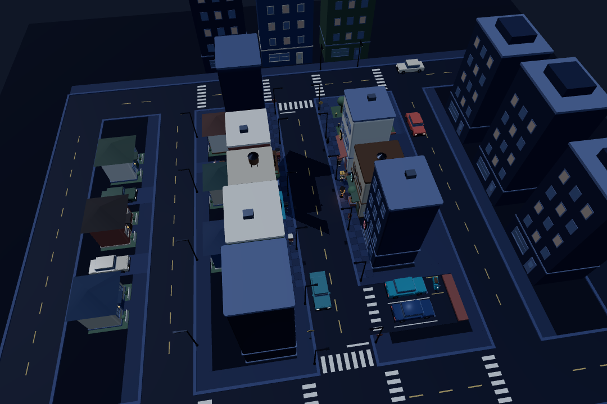
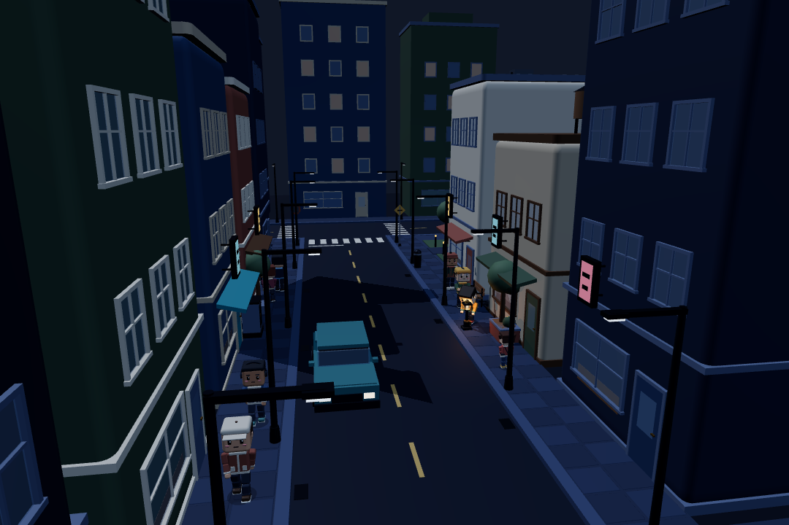
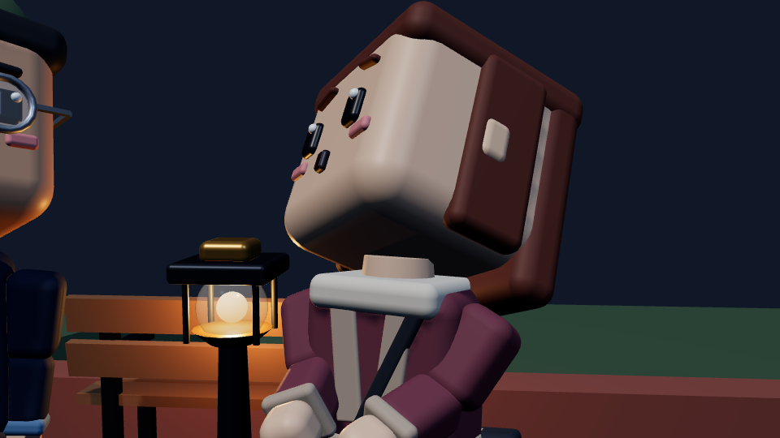

# BLOCKY TOY Showcase — *The Last Little Light*

These verified screenshots and videos were produced with the methodology encoded in **BLOCKY TOY** (`blocky-toy`) using a code-based Three.js / React Three Fiber + Playwright Chromium + FFmpeg + zero-key `msedge-tts` pipeline (`42s`, `1080×1920 @ 30 FPS`).

---

## Video Demos

- **Full Short Film Showcase (540×960, 42s, mixed audio)**: [`docs/media/showcase-film-540p.mp4`](./media/showcase-film-540p.mp4)
- **Dialogue Performance & Lip-Sync QA Suite (960×540, 41s, 7 acts)**: [`docs/media/dialogue-qa-demo.mp4`](./media/dialogue-qa-demo.mp4)

---

## 1. Worldbuilding & Spatial Common Sense

Connected urban blocks (`Commercial`, `Residential Maple Lane`, `Pocket Park`, `Commercial Parking Lot`, and outer perimeter connectors), intersection-only zebra crossings, lane-facing signs, and zero parked vehicle overlaps:

| Elevated Urban Masterplan Overview | Main Commercial Avenue & Traffic |
| :---: | :---: |
|  |  |

---

## 2. Character Identity Lock & Visual Diversity

Eight distinct individuals (`Leo`, `Mina`, `Andi`, `Raka`, `Bintang`, `Dina`, `Sari`, `Pak Hendra`) featuring non-cloned silhouettes, varied sleeves (`long` vs. `rolled`), footwear (`hi_tops`, `sneakers`, `loafers`, `boots`), facial details, and 360°-readable hairstyles:

| Cast Turnaround — Front Lineup | Cast Turnaround — Back View (360° Hair & Gear) |
| :---: | :---: |
|  |  |

---

## 3. Character Acting, Dialogue Turn-Taking & Lighting Continuity

On-screen character conversation with WAV RMS-aligned visemes, closed mouths during external narration, eye-contact tracking, delayed listener reactions, and moonlit key shadows synchronized to sky/fixture sources:

| Film Scene 4 — Leo & Mina Dialogue Two-Shot | Dialogue QA Act 3 — Expressive Reaction & Gaze |
| :---: | :---: |
|  |  |
